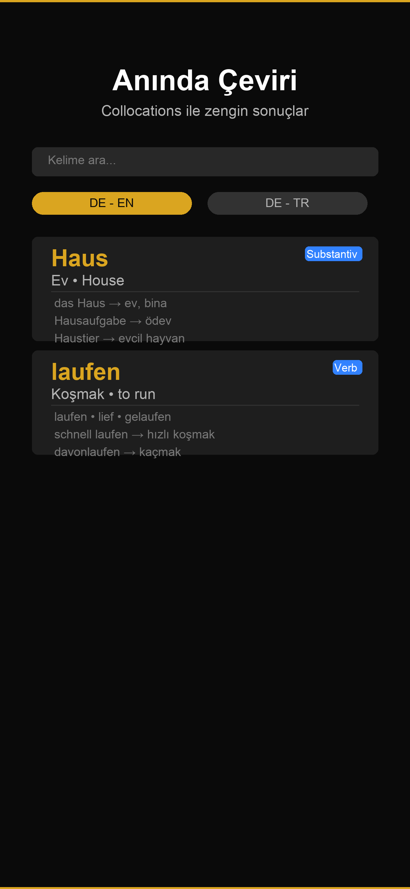
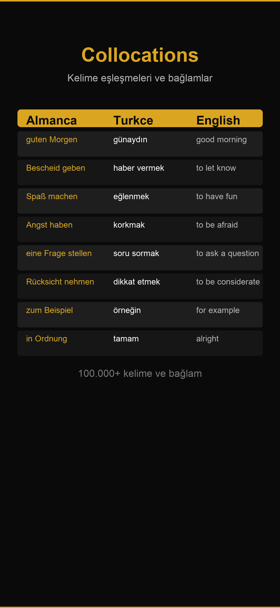
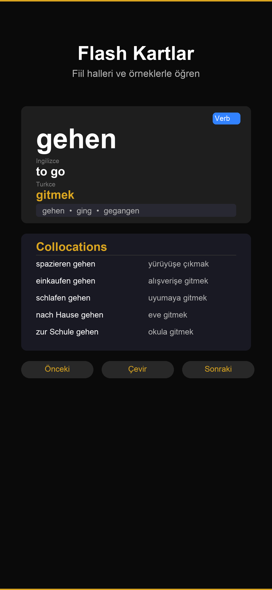

# Langur
### German · Turkish · English Dictionary
Search vocabulary, explore source-backed examples, and practice with flashcards.

**iOS 17+ · Offline dictionary · No account required**

## Explore the app

| Search | Word details | Practice |
|---|---|---|
|  |  |  |

*Screenshots show an earlier app version; the notes below describe version 1.1.0.*

## What you can do

- Search German vocabulary with Turkish and English meanings, including reverse lookup.
- See the most common usage patterns of a word (e.g. *sich freuen auf + Akk.*) with example sentences and English/Turkish translations.
- Type a verb to see its forms at the top of search: Präsens, Präteritum, Partizip II and Perfekt, plus full person tables.
- Find inflected forms (ging → gehen), search with articles ("das Haus"), and explore compounds, phrases and synonyms.
- Tap words in example sentences to continue exploring the dictionary.
- Practice with spaced-repetition flashcards, article and meaning quizzes and the word of the day; revisit favorites and search history.
- Use the bundled dictionary offline, without an account.

Not every dictionary entry has a translation or example in every language. Langur shows available source data rather than inventing missing content.

## Latest version — 1.1.0 (11)

The dictionary now contains **115,825 entries**; every entry's English and Turkish meanings were reviewed.

- Usage-pattern tables for **6,371 words**, each with example sentences and English/Turkish translations.
- Verb-forms card in search and on word pages for **9,288 verbs** (from a reviewed table and Wiktionary data — no guessed forms).
- **61,664 entries corrected**; missing everyday words restored (frei, stolz, gefallen, Essen, Leben…); noun genders (der/die/das) fixed.
- Synonyms for **13,893 words** (OpenThesaurus).
- Spaced-repetition flashcards, article and meaning quizzes, word of the day and recent searches.
- Smarter search, refreshed design, improved dark mode, VoiceOver and large-text support.

These notes describe the project snapshot; they do not confirm the current App Store release status. See [change history](CHANGELOG.html).

## Privacy and sources

Dictionary lookup uses bundled data. Favorites, history, study progress and translation history stay on your device. No account is required.

- [Privacy policy](PRIVACY.html)
- Dictionary sources: WikDict/DBnary, Wiktionary and Kaikki (incl. verb conjugations). Synonyms: OpenThesaurus (CC BY-SA 4.0).
- Example source: Tatoeba. Source and license attribution is also available in the app.

## Support

For bugs, missing translations or suggestions, [open an issue](https://github.com/emircanby/langur-support/issues) or email **emircanby@gmail.com**.

Include the app version, your language direction, the search term, and steps to reproduce the problem. Avoid including personal information in public issues.

Developer: **Emircan Yayla** · © 2026. All rights reserved.
